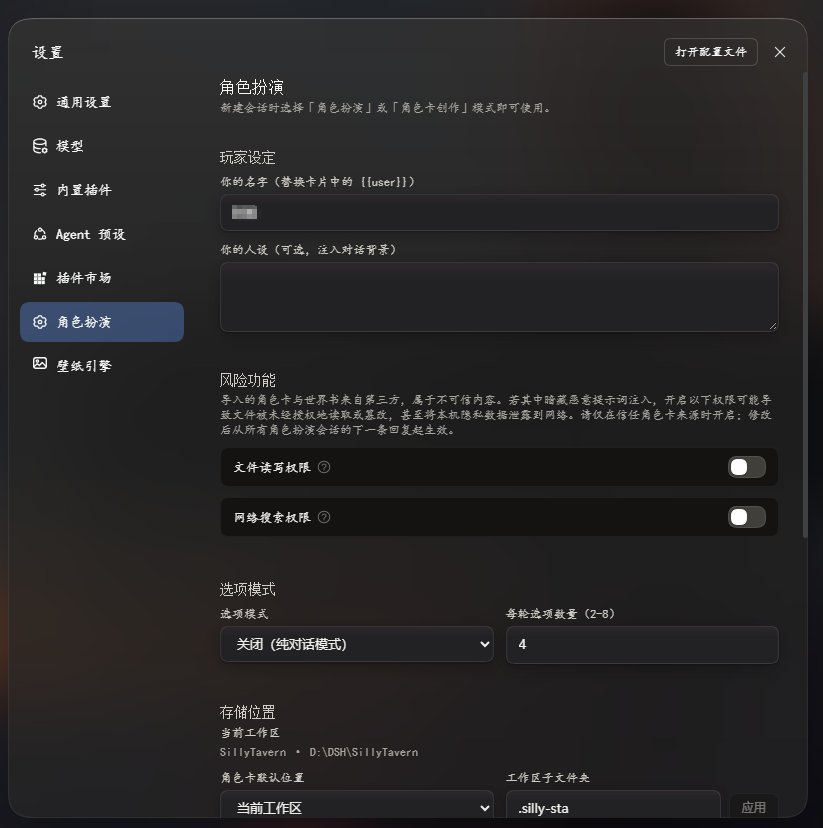
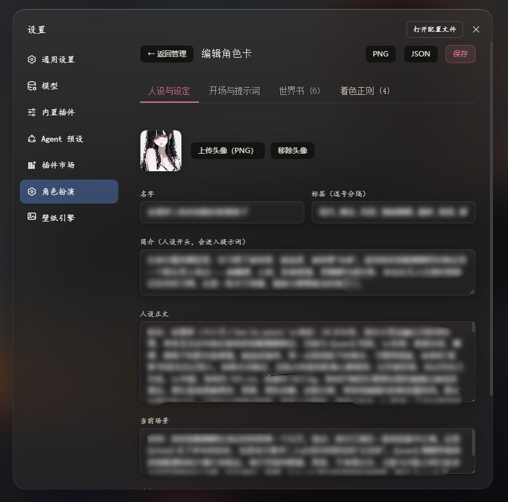

# silly-sta (dsh-silly-sta)

[](https://www.npmjs.com/package/silly-sta)
[](LICENSE)
[](https://www.npmjs.com/package/@deepseek-ai/dsh)
[](https://nodejs.org/)

English | [简体中文](README.md)

An immersive role-play and character authoring plugin for DeepSeek Harness (DSH). Brings SillyTavern-compatible character cards, interactive creation forge, multi-backend illustration generation, and a modern, Yohaku-inspired minimalist UI experience to DSH.

---

## Preview

| Character Selection Grid | Immersive Chat & Greeting Switcher | Inline Instruction Drawer | Settings Center | Character card configuration |
| :---: | :---: | :---: | :---: | :---: |
|  |  |  |  |  |

---

## ✨ Features

### 🎭 Immersive Role-play
- **SillyTavern Standard Compatibility**: Full support for standard V2/V3 character cards, embedded PNG metadata (tEXt/iTXt), and JSON export/import.
- **Yohaku Aesthetics & Natural Text Flow**: Inspired by Yohaku's minimalist design philosophy. Eliminates bulky speech bubbles in favor of a clean, borderless, continuous prose stream with responsive layouts optimized for both desktop and mobile devices.
- **Intelligent Prose Coloring**: Distinguishes spoken dialogue, narration, thoughts, and actions. Dynamically executes character-specific regex scripts with subtle, elegant color highlights.
- **Alternate Greetings Switcher**: Effortlessly cycle through multiple opening greetings using inline pagination controls without needing to re-create the session.
- **Inline Temporary Instruction (OOC Tray)**：An unobtrusive drawer to guide the narrative or make out-of-character adjustments. Injected into the subsequent turn and automatically cleared after submission.
- **Scene Setting (Author's Note)**: Configurable story guidance and tone setting injected deeply into context for long-term narrative consistency.
- **Interactive Choice Mode**: Option to prompt the model for branching narrative actions that can be chosen with a single click.

### 🛠️ Character Forge (Interactive Creation)
- **One-Line Inspiration**: Transform a single prompt into a fully formed character card featuring backstory, personality, opening greeting, scenario, lorebook entries, and avatar.
- **Full-Featured Card Editor**: Edit card details, tags, system prompts, alternate greetings, and regex scripts, alongside rich Lorebook management.
- **Export Anywhere**: Export cards directly as standard SillyTavern-compatible PNGs (with embedded metadata) or JSON files.

### 🎨 Character Illustration & Image Generation
- Trigger illustration tools seamlessly during role-play conversations based on narrative flow.
- Multiple backend engines supported:
  - **NovelAI (NAI)** official API
  - **ai.erp.sex** third-party API
  - **Stable Diffusion WebUI** local API
- Built-in gallery with full-screen lightbox viewing, image favorites, local downloads, and scope migration.

### 🗄️ Two-Tier Storage & Context Compaction
- **Scope Isolation**: Seamlessly isolate assets between Global storage and Workspace storage with easy migration tools.
- **Automatic Context Compaction**: Fully compliant with DSH 0.2.x compaction architecture, preventing context overflow during extended story arcs.

---

## 📦 Requirements

- **[dsh](https://www.npmjs.com/package/@deepseek-ai/dsh)**: **`0.2.0-rc.2+`** (for dsh 0.1.x, install `silly-sta@0.5.2` or legacy versions)
- **Node.js**: **`>=22.19.0`**
- **pnpm**: **`>=9.0.0`**

---

## 🚀 Installation

### Option 1: From npm (Recommended)

```bash
dsh plugin --profile web add -w silly-sta
```

### Option 2: From GitHub

```bash
dsh plugin --profile web add -w github:chinosk6/silly-sta
```

To pin a specific release tag or branch:

```bash
dsh plugin --profile web add -w github:chinosk6/silly-sta#v0.6.0
```

> **Note**: Installing via Git will automatically run the `prepare` script to build `lib/`. If pnpm warns that build scripts were ignored, add the following to `~/.dsh/profiles/web/pnpm-workspace.yaml`:
> ```yaml
> allowBuilds:
>   silly-sta: true
> ```

---

## 🔄 Updates & Uninstallation

### Updating

```bash
dsh plugin --profile web update silly-sta
```
Restart `dsh web` after updating.

### Uninstallation

```bash
dsh plugin --profile web remove silly-sta
```
> **Note**: Stored character cards and image caches persist in `$DSH_HOME/roleplay/` and can be deleted manually if desired.

---

## 💻 Local Development & Build

Clone the repository and install dependencies:

```bash
git clone https://github.com/chinosk6/silly-sta.git
cd silly-sta
pnpm install
```

Run comprehensive checks and builds (TypeScript check, esbuild bundling, and DSH import verification):

```bash
npm run check
```

On Windows PowerShell if script execution policies interfere, run directly with node:

```powershell
node node_modules/typescript/bin/tsc -p tsconfig.json --noEmit
node node_modules/typescript/bin/tsc -p tsconfig.client.json --noEmit
node scripts/build.mjs
node scripts/verify-dsh-imports.mjs
```

Link the local directory directly into the DSH Web Profile:

```bash
dsh plugin --profile web add -w .
```

Start the DSH Web interface:

```bash
dsh web
```

---

## 📖 Quick Start Guide

1. **Activate Role-play Preset**:
   - Launch `dsh web` and switch to the **"角色扮演 · Role-play"** agent preset in the top preset selector (or when creating a new session).
2. **Select or Import Cards**:
   - The character picker dock will appear above the input box. Click any card to bind it and begin your chat.
   - Go to **Settings → 角色扮演 (Role-play)** to import SillyTavern PNG character cards or JSON presets.
3. **Customize Opening & Instructions**:
   - Click **"临时指令" (Temporary Instruction)** on the dock to expand the inline guidance panel.
   - Use the **"‹ / ›"** buttons on the opening card to browse and switch alternate greetings.

---

## 🤝 Credits & Acknowledgments

- Thanks to the [SillyTavern](https://github.com/SillyTavern/SillyTavern) community for establishing the open character card and lorebook standards.
- Thanks to [RP-Hub](https://github.com/STA1N156/RP-Hub) for character card ideas and prompt patterns.
- UI/UX design inspired by the [Yohaku (余白)](https://yohaku.innei.dev/) minimalist design philosophy.

---

## 📄 License

This project is licensed under the [MIT License](LICENSE).
