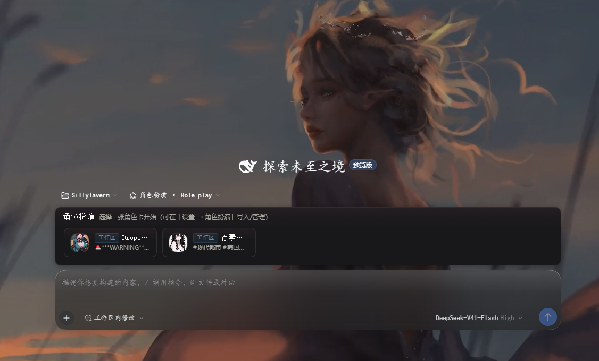
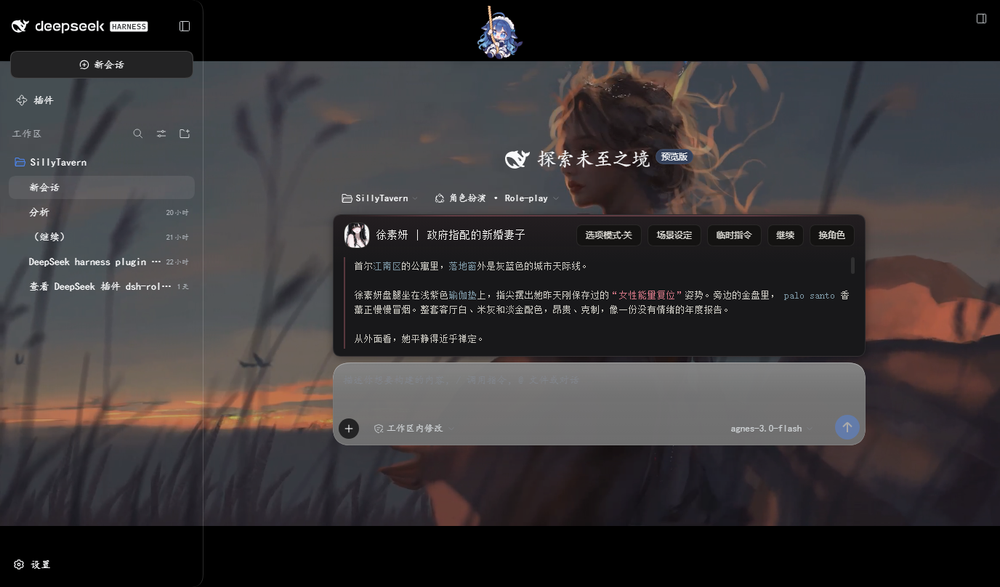
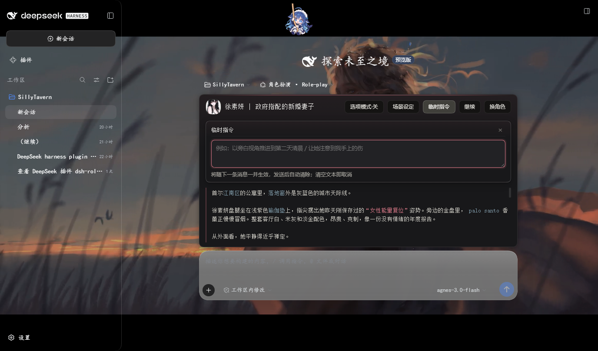

# silly-sta (dsh-silly-sta)

[](https://www.npmjs.com/package/silly-sta)
[](LICENSE)
[](https://www.npmjs.com/package/@deepseek-ai/dsh)
[](https://nodejs.org/)

[English](README-EN.md) | 简体中文

DeepSeek Harness (DSH) 沉浸式酒馆角色扮演与角色卡创作插件。为 DSH 带来与 SillyTavern 兼容的角色卡生态、灵感创作工坊、多接口角色插画生成以及 Yohaku 风格的现代极简交互体验。

---

## 界面预览

| 角色选择网格 | 沉浸式对话与开场白切换 | 临时指令抽屉 |
| :---: | :---: | :---: |
|  |  |  |

---

## ✨ 核心特性

### 🎭 沉浸式角色扮演 (Role-play)
- **酒馆标准兼容**：无缝支持 SillyTavern / Tavern 规范角色卡（V2/V3 规范、PNG 头像内嵌元数据、JSON 格式导入导出）。
- **Yohaku 美学与原生文本流**：参考 Yohaku 极简留白设计哲学，去除厚重气泡框，采用优雅通透的原生流式排版，完美兼容 PC 端与移动端触控交互。
- **高阶文本着色**：智能识别台词、旁白、心理描写与动作，支持读取角色卡自带的自定义正则高亮规则（Regex Scripts），呈现淡雅的情绪视觉层次。
- **多开场白实时切换**：支持拥有多个备选开场白（Alternate Greetings）的角色卡，直接在对话顶部/底部进行翻页预览与一键生效。
- **临时指令 (OOC Tray)**：内联呼出临时引导面板，指令将随下一轮对话作为系统级提示注入并自动销毁，无需污染主对话流。
- **场景设定 (Author's Note)**：支持全局/临时注入场景基调与深度提示词，控制情节走向。
- **分支选项模式 (Choice Mode)**：在关键情节处由 AI 提议多种下一步行动策略，玩家可一键点击决策。

### 🛠️ 角色卡创作工坊 (Character Forge)
- **灵感一键成卡**：只需一句灵感描述，大模型即可交互式推演并生成完备角色卡（名字、人格、场景、世界书、开场白与头像）。
- **全功能内置编辑器**：支持在线编辑角色基础资料、标签、高级提示词、示例对话、备选开场白、世界书条目（Lorebook）增删改查及正则脚本。
- **便携打包导出**：一键将卡片导出为标准的 PNG 图片卡（内嵌角色元数据）或标准 JSON 文件，随处分享。

### 🎨 多接口角色插画与生图 (Illustration)
- 对话中支持根据剧情与角色外貌提示词按需调用插画生成工具。
- 支持多种主流生图后端：
  - **NovelAI (NAI)** 官方接口
  - **ai.erp.sex** 第三方接口
  - **Stable Diffusion WebUI** 本地 API
- 内置画廊（Gallery）系统，支持全屏灯箱查看、收藏、本地导出以及全局/工作区存储域归档。

### 🗄️ 双层存储域与上下文智能维护
- **作用域隔离**：支持「全局存储（Global）」与「工作区存储（Workspace）」两级分类，卡片与插画可跨空间迁移。
- **长文本上下文压缩**：无缝接入 DSH 0.2.x 体系，支持自动 Compaction 机制，超长对话剧本永不爆显存/超出模型上下文。

---

## 📦 环境要求

- **[dsh](https://www.npmjs.com/package/@deepseek-ai/dsh)**: **`0.2.0-rc.2+`**（若使用 dsh 0.1.x 请安装 `silly-sta@0.5.2` 或旧版包）
- **Node.js**: **`>=22.19.0`**
- **pnpm**: **`>=9.0.0`**

---

## 🚀 安装

### 方式一：从 npm 安装（推荐）

```bash
dsh plugin --profile web add -w silly-sta
```

### 方式二：从 GitHub 安装最新版本

```bash
dsh plugin --profile web add -w github:chinosk6/silly-sta
```

如需指定特定 Release 标签或分支：

```bash
dsh plugin --profile web add -w github:chinosk6/silly-sta#v0.6.0
```

> **提示**：从 GitHub 安装会自动触发 `prepare` 脚本构建 `lib/`。若 pnpm 提示忽略了构建脚本，可在 `~/.dsh/profiles/web/pnpm-workspace.yaml` 中添加：
> ```yaml
> allowBuilds:
>   silly-sta: true
> ```

---

## 🔄 更新与卸载

### 更新插件

```bash
dsh plugin --profile web update silly-sta
```
更新完成后重启 `dsh web` 即可。

### 卸载插件

```bash
dsh plugin --profile web remove silly-sta
```
> **注意**：已保存的角色卡与插画缓存保留在 `$DSH_HOME/roleplay/` 中，如需彻底清除可手动删除该目录。

---

## 💻 本地开发与构建

克隆仓库并安装依赖：

```bash
git clone https://github.com/chinosk6/silly-sta.git
cd silly-sta
pnpm install
```

执行完整校验构建（包含 TypeScript 类型检查、esbuild 打包与 DSH 注入依赖校验）：

```bash
npm run check
```

Windows PowerShell 环境下若遇到脚本执行策略限制，可直接运行：

```powershell
node node_modules/typescript/bin/tsc -p tsconfig.json --noEmit
node node_modules/typescript/bin/tsc -p tsconfig.client.json --noEmit
node scripts/build.mjs
node scripts/verify-dsh-imports.mjs
```

将本地开发目录直接软链/挂载至 DSH Web Profile：

```bash
dsh plugin --profile web add -w .
```

启动 DSH Web 实例验证：

```bash
dsh web
```

---

## 📖 使用指南

1. **进入角色扮演模式**：
   - 启动 `dsh web`，在顶部预设选择器中切换至 **「角色扮演 · Role-play」** 预设（或在新建会话中选择）。
2. **选择/导入角色卡**：
   - 输入框上方会自动加载角色卡 Dock，点击任意卡片即可绑定并开始对话。
   - 可在侧边栏 **「设置 → 角色扮演」** 中批量导入酒馆 PNG 角色卡或 JSON 预设。
3. **临时指示与开场白定制**：
   - 点击 Dock 栏上的 **「临时指令」** 可展开输入指导文本（如剧情跳跃、旁白要求等）。
   - 点击 **「‹ / ›」** 即可实时预览并切换不同开场白。

---

## 🤝 致谢与参考

- 感谢 [SillyTavern](https://github.com/SillyTavern/SillyTavern) 社区制定的角色卡与世界书开放生态规范。
- 感谢 [RP-Hub](https://github.com/STA1N156/RP-Hub) 项目在角色卡设计与提示词方案上的启发。
- UI/UX 视觉灵感借鉴自 [Yohaku (余白)](https://yohaku.innei.dev/) 极简设计规范。

---

## 📄 开源许可证

本项目基于 [MIT License](LICENSE) 开源。
